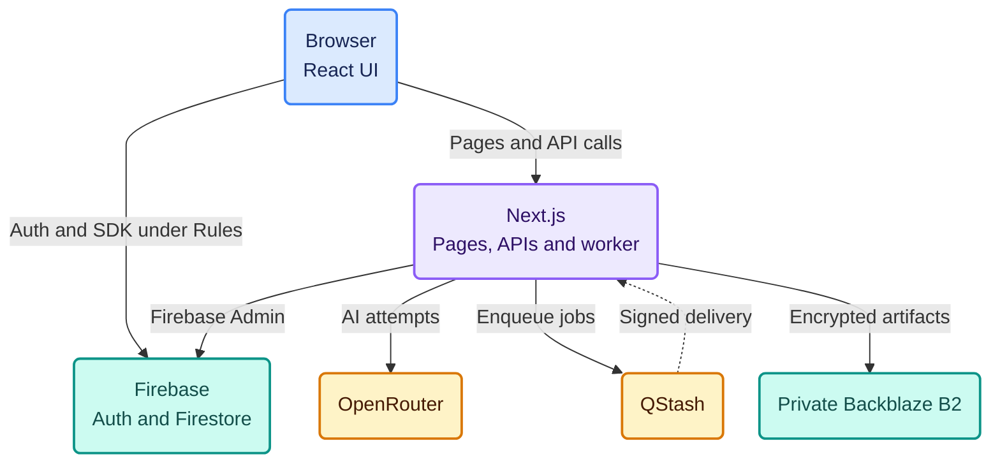

# 🏗️ System Architecture · Shark Empti **v2.2.0**

Shark Empti is a Next.js App Router application with Firebase for identity and persistence, OpenRouter for learning assistance, and optional background services for account data operations. This guide maps the runtime components, the boundaries between them, and the recovery model for work that spans requests.

## 🗺️ System overview

The root layout renders the initial theme and language from a preference cookie. The page proxy attaches the resource policy and passes the response nonce to the renderer. The route provider loads Firebase on application routes. Public information pages can render independently of Firebase. Dashboard, Playground, math rendering and Focus Shield load their feature code when needed. Focus Shield uses camera permission and bundled TensorFlow assets for inference in the browser.

[Route providers](../src/components/route-providers.tsx) · [Browser security policy](CONFIGURATION.md#browser-security-policy) · [Interface design](DESIGN.md)

## 🔐 Identity, ownership and data boundaries

Firebase Auth provides the learner identity. The application bootstraps the profile and checks the server-owned service acknowledgement before opening signed-in learning surfaces. Account-data controls have a separate entry point so owners can reach them when learning setup is incomplete. Protected API operations verify Firebase ID tokens and apply the authorization and admission checks for that operation. Server-side Firebase Admin access depends on these route and transaction checks. Browser SDK access depends on Firestore Rules.

| Data | Read path | Write boundary |
|---|---|---|
| Learning history, flashcards and practice | Owner-scoped Firestore reads | Authenticated APIs validate record writes and commit them with stable retry identity. Rules retain an owner deletion path subject to account barriers. |
| Profile, notes and activity | Firestore SDK. Profile lookup by exact UID has a restricted public shape. | Rules bound supported SDK writes. Notes compare the starting revision in a transaction. |
| Forum and Arena | Versioned public feed, comment, exam and ranking projections. Owner reactions and ranking pointers are private. | Server APIs update canonical records and projections. Arena answer keys and scoring stay on the server. |
| Consent, AI ledger and account jobs | Application API responses scoped to the caller or receipt. | Server transactions and worker leases control mutations. |
| Preferences and unfinished work | Preference cookie and browser storage | Language and theme synchronize across tabs. Owner-scoped session drafts support recovery in the same tab. |

[API and authorization contracts](TECHNICAL_DOCUMENTATION.md) · [Backend data map](backend.json) · [Firestore Rules](../firestore.rules)

## 🔄 Work that spans requests

| Flow | Durable record and recovery |
|---|---|
| Learning writes | A stable record ID and fingerprint let the client retry the same completed result after losing the response. A separate feedback update can attach analysis to a saved quiz. |
| AI generation | The owner-bound ledger records claims, results and retry decisions. One eligible attempt makes one provider call. After losing an attempt response, the browser checks the ledger before claiming again. |
| Account export or deletion | Firestore stores the job, lease and progress cursor. QStash delivers work, and the signed maintenance schedule resumes due jobs. Deletion admission locks writes. The worker processes private data and attributable contributions, then removes Auth. The independent receipt endpoint exposes limited status. |
| Backup and restore | The worker writes encrypted parts to private B2. Operators restore into a separate target and reconcile deletion history before promotion. Firestore-only retention can run with signed queue configuration independently of account jobs and B2. |

[Application and recovery flows](FLOW.md) · [AI request lifecycle](TECHNICAL_DOCUMENTATION.md#ai-request-lifecycle) · [Account jobs and isolated restore](ACCOUNT_OPERATIONS.md)

## 🧪 Environments and verification

The local demo uses Firebase Auth and Firestore Emulators with a deterministic AI fixture for browser tests. Deployment supplies the public Firebase settings at build time and server credentials through the deployment environment. Account jobs use signed destinations scoped to their environment. Client code, Firestore Rules and indexes, and any required data migrations need coordinated rollout.

Validation covers unit and component behavior, Emulator Rules and transactions, browser flows and an Emulator export/import drill. Pull requests select additional Emulator suites by changed path, and release validation runs the full matrix. Hosted HTTP headers, real identity and AI providers, and staging recovery timing have separate verification steps.

[Configuration and release procedure](CONFIGURATION.md#release-procedure) · [Validation matrix](VALIDATION.md#prerequisites-and-isolation) · [Browser compatibility evidence](VALIDATION.md#optimized-build-and-browser-matrix) · [Audit register](AUDIT_REPORT.md)
