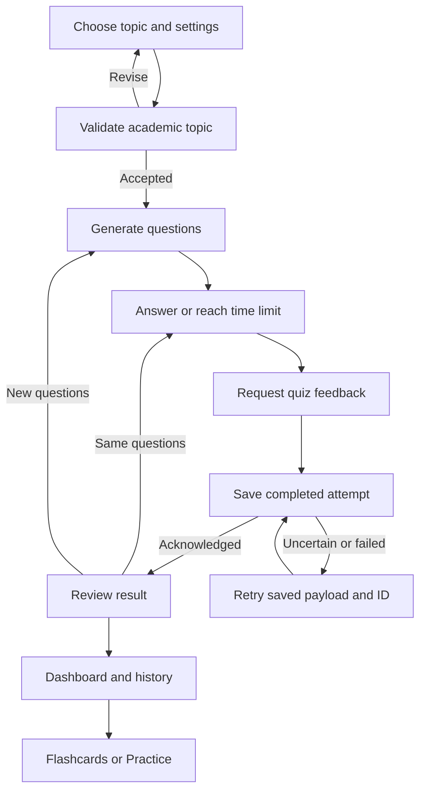

# Application and operational flows · Shark Empti **v2.2.0**

This guide follows a learner, moderator or operator from an entry point to the resulting screen, stored record or recovery action. The same Quiz interface serves two different journeys. A personal quiz writes learning history. An Arena attempt sends answers to the server for scoring and may update a public ranking.

For field definitions, collection paths and component ownership, see the [backend data map](backend.json) and [technical documentation](TECHNICAL_DOCUMENTATION.md).

## Entry, identity and consent

| Entry point | What happens | Next step or recovery |
|---|---|---|
| Home `/` | The server provides the page shell and a no-script introduction. The client resolves Firebase Auth, shows the public introduction to guests and loads the learning app for a learner. | Private views include Setup, Dashboard and Playground. Links can select these views through the `view` query parameter. |
| `/about`, `/privacy`, `/terms`, `/cookies`, `/community`, `/contact` | Visitors can read service information and follow links to sign-in, community guidance or account controls. The route provider skips Firebase and camera setup on these pages. | The site also serves robots, sitemap, social-image and `/llms.txt` responses. Canonical site configuration controls search discovery. Unknown routes have a return-home action. |
| `/login` and `/register` | Both use the age-confirmation form and Google popup. Opening the popup starts loading the learner modules. A restored sign-in enters through the Auth observer. | On a UID change the provider remounts private UI and prunes drafts belonging to other users. Auth initialization and profile preparation have retry states. |
| Service acknowledgement | During signed-in app entry, the provider prepares the profile and loads the consent UI. The consent component reads the server status. A learner who needs to acknowledge the policy confirms its terms and minimum age before entering. | The server records the applicable policy and acceptance time in `_serviceConsents/{uid}`. Existing consent is checked again on protected operations. The guest form alone does not grant access. |
| `/account/data` and `/account/status` | An authenticated owner can open data controls before completing learner setup. The receipt page accepts a deletion credential after sign-out. | A learner with a profile or consent problem can still reach these independent account flows. |

Language and theme start with the preferences cookie and synchronize between tabs. Language changes affect labels and available bilingual feedback. Learner-authored text stays in its original language. [Route providers](../src/components/route-providers.tsx) · [Auth and bootstrap](../src/firebase/auth-provider.tsx) · [Consent UI](../src/components/service-consent.tsx) · [Preferences](../src/components/app-preferences.tsx)

## Personal learning

1. **Configure the quiz.** Setup collects the topic, optional subject and grade, question type, difficulty, count, exclusions and optional time limit. It checks the numeric settings, snapshots the form and requests academic validation. An invalid topic returns the learner to Setup with a reason. A new attempt gets a UUID.
2. **Answer questions.** The quiz generates questions or accepts the supplied set for a retake. Choices and matching text are checked locally. Numeric short answers use the scalar comparison rule. Other eligible short answers go through AI evaluation. An uncertain evaluation leaves the answer available for retry. A fresh personal timer starts when generation delivers the questions. A restored attempt uses its saved start time. Short answers accept up to 2,000 characters. Expiry fills the remaining unanswered positions.
3. **Finish and persist.** The quiz requests bilingual feedback. A completed personal attempt can be saved even if that request fails. The session freezes the answers, configuration, language, completion time and any feedback, then sends a learning-record PUT. The server validates the record and writes history, its fingerprint and the write reservation in a transaction. A matching replay returns the existing record. Changed content under the same ID conflicts.
4. **Recover and review.** An interrupted attempt can restore progress in the same tab. A checkpoint containing a finished payload takes precedence over an older question draft. Result offers answer review, copy, a retake with the same or new questions, and navigation to Dashboard. Recovering missing AI feedback patches the saved analysis and topic labels.

[Setup](../src/components/setup-view.tsx) · [Quiz](../src/components/quiz-view.tsx) · [Session and save recovery](../src/hooks/use-learning-session.ts) · [Result](../src/components/result-view.tsx)

| Learner action | Data and outcome |
|---|---|
| Open Dashboard | Setup can preload history when idle. Dashboard and Playground request it immediately. A live first page reads up to 50 history documents ordered by completion time. Load more uses a document cursor. A changed first page invalidates older pages. Charts, errors, insights and recommendations describe the loaded rows. |
| Follow a recommendation | A topic action opens the corresponding Playground tab with the selected concept. Roadmap checkmarks use owner-scoped browser storage and synchronize locally. |
| Study flashcards | A learner with history selects a topic and card count. Starting locks the topic and count through validation and generation. The deck, draft and archive use the selected topic. The client displays the deck and attempts to archive it under `users/{uid}/flashcards`. Flip, previous and next update the current card. The same-tab draft remembers the deck, position and side. |
| Practise a weakness | Practice holds the chosen topic and count fixed during validation and generation. It derives candidate concepts from history with mistakes. The learner selects a concept and count, validates it and generates a set. Each answer receives feedback. On the last answer, the client writes questions, answers and score to `users/{uid}/practice`. The completion view follows acknowledgement. Retrying the set starts a new practice record. |
| Ask Shark Guru | A learner can type in chat or open it from question feedback. Guru reserves space for the current message and quiz summary. Within the 131,072-byte UTF-8 JSON limit it includes recent completed exchanges and quiz questions, giving priority to questions mentioned in the message and incorrect answers. An oversized message stays editable. The Arena attempt withholds coaching during answering. |
| Use personal notes and activity | Quick Notes and Dashboard share `users/{uid}/notes/main`. Editing becomes available after Firestore confirms the current account’s note or its absence. A failed subscription offers Reload notes. Saving writes the note text and timestamp. The activity calendar observes `users/{uid}/activity/main` and merges a local calendar-day entry. Both use the Firestore client under Rules. |
| Open Profile | The learner can edit a biography, copy their UID, look up a profile by exact UID or sign out. Opening the report selector starts history loading. Search, sort and select sessions, then generate a preview from the selected rows. Copy and print use that selection, with a separate print layout for charts and tables. |
| Start Focus Shield | The learner opens the widget and enables tracking. Camera permission, video playback and the on-demand TensorFlow model precede the first score. Sampling pauses when the document is hidden. Minimizing detaches the video and keeps the stream for reopening. Stopping or closing releases owned tracks, timers and model resources. Permission or model failures surface in the widget. |

[History reader](../src/hooks/use-history.ts) · [Dashboard](../src/components/dashboard-view.tsx) · [Playground](../src/components/playground-view.tsx) · [Chat](../src/components/ai-chatbot.tsx) · [Report selection](../src/hooks/use-profile-report.ts) · [Focus session](../src/components/focus-tracker-session.ts)

### Leaving, returning and retrying

| Event | Where the learner resumes |
|---|---|
| First visit to a feature | Its help dialog can open automatically. A browser-local flag records that the introduction has been shown. The help button opens the instructions again. |
| Reload or leave an unfinished activity | Quiz, Practice, Flashcards and Arena keep separate owner-scoped drafts in session storage. Reads check size, expiry and payload shape. Availability depends on storage in the same tab. Discarding a draft or signing out removes the corresponding recovery state. |
| Resume a Quiz draft produced by an older grader | A generated feedback field longer than 20,000 characters is cleared in the local recovery payload. The learner’s answers, score, timing and retry identity carry forward. This applies to both in-progress answers and pending saves. |
| A history or list read fails | The reader exposes an error and retry action. Malformed individual rows are counted and skipped. Retrying the query starts a new first page. |
| A render fails | Feature and route error boundaries offer recovery. Clipboard, camera and network actions handle their failures at the action that initiated them. |

[Draft storage](../src/lib/draft-storage.ts) · [Draft schemas](../src/lib/learning-drafts.ts) · [Paged reads](../src/hooks/use-paged-collection.ts) · [Feature help](../src/components/feature-help.tsx) · [Error boundary](../src/components/error-boundary.tsx)

## AI requests and recovery

| Operation | Called from | Result consumed by the caller |
|---|---|---|
| `academic-validation` | Quiz and Arena setup, Flashcards, Practice | Accepts the topic or returns a reason to revise it. |
| `generate-questions` | Personal quiz generation and Arena creation | A question set matching the requested count. Arena requires eligible short-answer keys before publication. |
| `generate-flashcards` | Flashcards | Front/back pairs for the deck and archive. |
| `generate-practice` | Practice | Questions, options where applicable, correct answers and explanations. |
| `short-answer-analysis` | Personal Quiz and Practice | A correctness decision, confidence from 0 to 1 and feedback up to 20,000 characters. Confidence below 0.8 leaves the answer open for retry. |
| `personalized-quiz-feedback` | Quiz completion and feedback recovery | English and Vietnamese topic labels, analyses, error categories and cognitive metrics. |
| `ai-coaching-chatbot` | Shark Guru | A reply for the current conversation. |

1. The client creates a generation UUID and sends the operation and input with a Firebase ID token. The creation route checks admission, parses bounded input and creates or replays an owner-bound record in `_aiGenerations`.
2. The attempt route claims the next attempt and reserves user/global quota in Firestore. It calls one OpenRouter model outside the transaction. Server configuration selects model priority. The adapter bounds the response body and validates the operation-specific output.
3. Finalization uses the matching lease to release concurrency and persist a result, retry decision or terminal error. A retryable outcome may advance to another model. The protocol allows up to three attempts.
4. If a creation response is lost, the client can replay the same creation. If an attempt response is lost, it reads status before claiming again. A status read can settle an expired lease. Cancellation becomes terminal immediately or after the active attempt settles. The generation lifetime also limits access before physical cleanup.

Production generation creation requires `AI_GENERATION_PROTOCOL_ENABLED=true`. The browser allows 30 seconds per request within a 120-second operation window. Each provider call has a 20-second deadline, and its Firestore lease lasts 35 seconds. These different clocks allow a client that missed an HTTP response to retrieve the server's decision.

[Operation registry](../src/ai/operation-registry.ts) · [Client recovery](../src/ai/client.ts) · [Generation store](../src/ai/generation-store.ts) · [Provider adapter](../src/ai/openrouter.ts)

## Community and moderation

| Journey | Execution and outcome |
|---|---|
| Browse Forum | Guests and learners can read versioned public posts and comments. Sorting and pagination query `forumPosts`. The signed-in learner's reaction indicators come from private owner records. Public counts and the learner's own state arrive through separate subscriptions. |
| Publish and discuss | A signed-in author composes a post or comment and submits it through the API. The transaction writes the canonical record and public projection, updates the parent counter where applicable and records the request receipt. Authors can edit their content. Likes express a desired state and synchronize membership, count and the owner's reaction record. |
| Remove content | Deleting a comment updates the affected records and parent counter. Deleting a post first removes its visible parent and records a deletion tombstone. The server then removes descendants in guarded batches. A pending deletion can resume from the owner's Forum controls. |
| Publish an Arena exam | A learner validates a topic and generates questions once for the creation request. The API validates the exam and commits public V2 metadata to `arenaExams` and the answer bank to `_arenaAnswerKeys`. A lost creation response can be retried with the retained request. |
| Enter an Arena challenge | Visitors can browse exams and the top ten rankings. An authenticated participant starts an attempt. The server verifies the exam and returns prompts and a server start time. A same-tab resume uses the previous attempt ID. Replaying an eligible start preserves the ranking clock. |
| Submit an Arena attempt | Before submission, the tab checkpoints the answers and start UUID. After a lost response, Resume replays that submission and retrieves the canonical review. If browser storage is unavailable, retry remains available in the mounted session. The server validates the session and timing, grades against the private bank, and commits the result and attempt count. Eligible first ranked completions create a private attempt, a public ranking and an owner pointer. Coins depend on score and the first eligible finisher bonus. The accepted response unlocks answer review. Authors, practice-only exams and ineligible retakes receive practice results. |
| Report and moderate | A signed-in learner reports a post, comment or exam with a reason. The report enters a private queue. A moderator with a current server-assigned claim opens the paginated open or hidden list and records a reason to dismiss, hide or restore. Hiding archives the source and withdraws the visible content. Restoring checks the archive, destination and relevant parent/deletion state. The report that hid the content owns its archive. Other open reports can be dismissed independently. A hidden legacy report whose archive is gone can also be dismissed. Decisions are recorded privately. |

[Forum API](../src/app/api/forum) · [Forum cleanup](../src/lib/forum-deletion.ts) · [Arena API](../src/app/api/arena) · [Leaderboard order](../src/lib/arena-leaderboard.ts) · [Moderation API](../src/app/api/community/moderation/route.ts)

## Account data, workers and recovery

1. **Request.** The owner opens Account data, reviews job availability and reauthenticates with Google. Export and deletion use a request UUID. Deletion also requires explicit confirmation. The transaction records the job and, for deletion, writes the account lock and deletion journal. The UI offers a deletion receipt to save locally.
2. **Dispatch.** The server reserves delivery credits and publishes a job ID and environment to QStash. The internal endpoint verifies the signature, destination and environment. A worker claims job and global leases, processes bounded batches and checkpoints its cursor. Quota pressure can move a job to `waiting_quota`. The signed maintenance sweep revisits due work.
3. **Export.** The worker pages identity, consent, private descendants and attributable records, packages encrypted parts in private B2 storage and produces a manifest. A ready export gives its owner a 24-hour download window through the API. Different pages can reflect changes made during export.
4. **Delete.** The worker releases owned AI reservations, deletes private data, removes or anonymizes attributable community data, cleans export artifacts and removes Auth last. On completion it retains a time-limited tombstone, journal and minimal receipt status. Public contributions retained under a former-member identity can still contain text written by the learner.
5. **Follow status.** Owner controls poll active jobs. The independent receipt page reads a saved credential or local receipt file and sends the credential in a header. Hidden tabs suspend polling. Transient failures have bounded retries, terminal results stop polling, and explicit refresh can restart a status read. Closing the page leaves server processing under worker control.
6. **Legacy interfaces.** The scoped export route pages selected learning datasets. The legacy request route records an export/deletion request for operator review. These paths have distinct results from the worker-backed job API.

The worker advances a durable job from `queued` to `running`. A partial step checkpoints progress and returns to `queued`. Quota delays use `waiting_quota`. A completed export becomes `ready` for download, while successful deletion and backup become `completed`. Terminal processing errors become `failed`. After addressing the cause, an owner can confirm deletion again to resume the locked checkpoint with the original receipt. A status-read failure is displayed by the client independently of these stored states.

[Account controls](../src/components/account-data-controls.tsx) · [Receipt](../src/components/account-receipt.tsx) · [Polling](../src/lib/account-polling.ts) · [Job store](../src/lib/jobs/store.ts) · [Account worker](../src/lib/jobs/account-worker.ts)

## HTTP route index

Paths below are relative to `/api`. Browser reads of public projections and owner learning data also use the Firebase client directly under [Firestore Rules](../firestore.rules).

| Route | Method and transition |
|---|---|
| `/account/consent` | GET reads current acknowledgement. POST records explicit acceptance. |
| `/ai/generations` | POST creates or replays a generation. |
| `/ai/generations/{generationId}` | GET reads or recovers status. DELETE requests cancellation. |
| `/ai/generations/{generationId}/attempt` | POST claims and executes an eligible attempt. |
| `/learning/{kind}/{recordId}` | PUT writes history, flashcards or practice. PATCH updates feedback for history only. |
| `/forum` | POST publishes a post. |
| `/forum/{postId}` | PATCH edits a post/comment or sets a reaction. DELETE starts or resumes post deletion. |
| `/forum/{postId}/comments` | POST adds a comment. DELETE removes the specified comment. |
| `/arena` | POST publishes an exam. |
| `/arena/{examId}/start` | POST starts or resumes a challenge. |
| `/arena/{examId}/submit` | POST grades a submission or replays its accepted result. |
| `/community/reports` | POST files a private report. |
| `/community/moderation` | GET pages a queue. POST records a moderation decision. |
| `/account/export` | POST exports one page of a scoped legacy dataset. |
| `/account/requests` | GET reads legacy requests. POST records a manual-review request. |
| `/account/jobs` | GET lists owner jobs and availability. POST requests an export or deletion. Reconfirming a failed deletion resumes its locked checkpoint. Receipt-only access shows status and directs the owner to sign in for recovery. |
| `/account/jobs/{id}` | GET reads owner status, minimal receipt status or an authorized export part. |
| `/internal/jobs` | POST accepts a signed worker delivery or maintenance tick. |

## Operator and development workflows

| Workflow | Trigger, work and completion |
|---|---|
| Firestore retention | A signed hourly maintenance delivery acquires a lease, rotates through expiry queries and rechecks candidates inside transactions. Firestore-only cleanup can run with retention enabled independently of B2 account jobs. With jobs configured, maintenance also handles due jobs and expired artifacts. |
| Backup | With account jobs and backups configured, maintenance creates a daily backup job. A timed write barrier covers Firestore traversal and Google Auth identity/claims capture. Encrypted parts and a manifest go to private storage. Successful completion and barrier release share a transaction. |
| Isolated restore and cutover | An operator selects a completed backup and an empty isolated target. Restore checks the manifest and parts, applies deletion history, imports retained data and identities and rebuilds community projections. Final reconciliation fences new source deletions and verifies the target. Promotion requires the source fence to remain held. Abandoning the cutover has an explicit release path. Interrupted initial imports restart on a fresh empty target. |
| Data migrations | Arena migration inventories legacy exams, preserves a backup and converts eligible records to practice-only. Community migration inventories Forum projections, reactions and Arena rankings before a fenced conversion. Learning-time migration inventories legacy dates and normalizes supported values in guarded transactions. Each script checks its target and distinguishes inventory from apply. |
| Local development and CI | Developers use the npm lockfile and run the dev server. CI runs lint, type checking, maintenance contracts, unit/component tests, a build, browser checks, bundle/smoke checks and dependency audit. Manual and release-tag runs add coverage, Rules/integration, restore drill and broader browser/print matrices. Demo runs use Auth/Firestore emulators and deterministic AI fixtures. |
| Operational checks and housekeeping | Configuration preflight checks settings. AI health/smoke scripts exercise different provider checks. Storage checks use synthetic objects. Performance scripts measure route bundles, browser behavior and query workloads. Generated evidence goes to report directories. Scoped cleanup scripts inventory or remove eligible artifacts. |

`RETENTION_ENABLED` enables the Firestore maintenance path with the required queue configuration. `ACCOUNT_JOBS_ENABLED` enables account processing and retention when the required services are configured. `ACCOUNT_BACKUPS_ENABLED` adds scheduled backups to that worker. An operator must also provision the signed schedule, credentials, storage and matching Rules/indexes in the target environment.

[Account operations and restore procedure](ACCOUNT_OPERATIONS.md) · [Migration configuration](CONFIGURATION.md) · [Verification and measurement](VALIDATION.md) · [CI workflow](../.github/workflows/ci.yml) · [Script entry points](../package.json)
